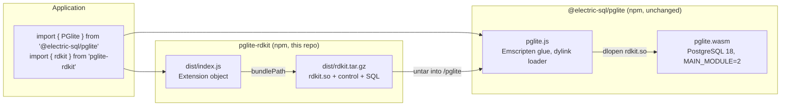
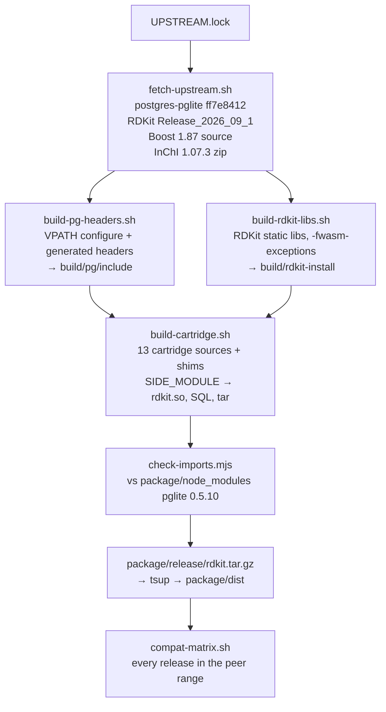
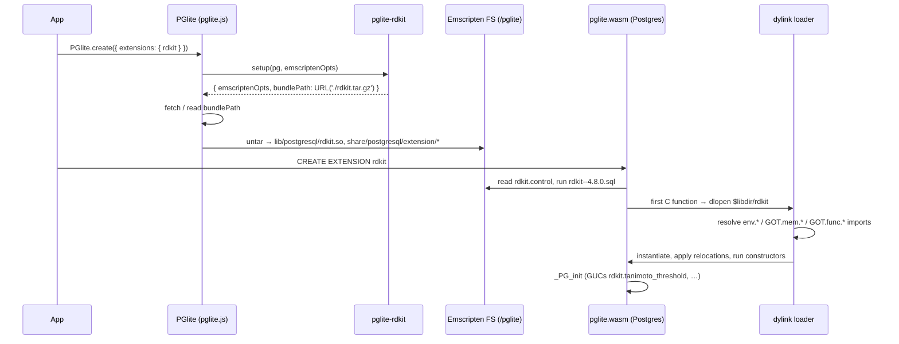
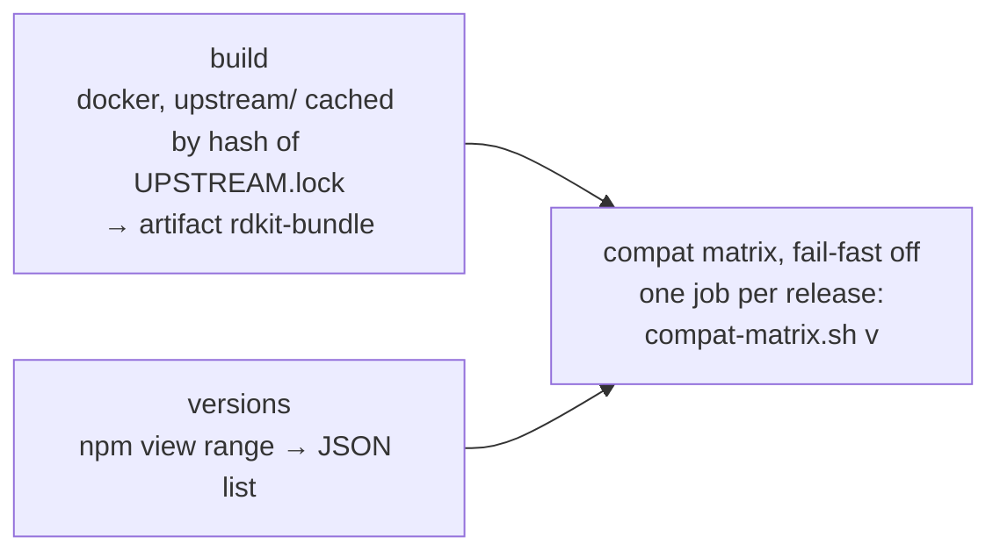

# Architecture

This document describes how `pglite-rdkit` builds the
[RDKit PostgreSQL cartridge](https://www.rdkit.org/docs/Cartridge.html) as a WebAssembly side
module, and how that module loads into the **published** npm
[`@electric-sql/pglite`](https://www.npmjs.com/package/@electric-sql/pglite) without any change to
PGlite. For usage and build commands, see [README.md](README.md).

| | |
|---|---|
| RDKit | `Release_2026_09_1` (`fece8caa`), cartridge extension version `4.8.0` |
| PostgreSQL | 18.6 (PGlite, wasm32, `SIZEOF_DATUM=4`, single-threaded) |
| Supported PGlite | `>=0.5.0 <0.6.0` (peer dependency), each release tested |
| Reference PGlite | `0.5.10`: headers from `postgres-pglite` `ff7e8412`, image `electricsql/pglite-builder:6.0.12-1` |
| Boost | 1.87.0, headers only |
| InChI | 1.07.3 (MIT), built in; Avalon optional (`RDKIT_FEATURES=avalon`) |
| Exceptions | native wasm EH (`-fwasm-exceptions`, legacy encoding) |

## Overview

PGlite loads extensions as Emscripten side modules (`.so` files that are wasm modules) from a
tarball that the extension's JS object points to. In-tree extensions get help from the PGlite build
itself: the main module exports exactly what they import, and its link flags define the C++
exception runtime. An out-of-tree extension gets neither. It must work with the symbols a given
`pglite.wasm` happens to export, and with a `pglite.js` whose `__cxa_throw` is `abort()`.
`pglite-rdkit` handles this with three choices:

1. All C++ in `rdkit.so` uses **native wasm exceptions**, and the module links its own
   `libc++`/`libc++abi`/`libunwind`, so throw/catch never leaves it.
2. **Shims** (`cartridge/pglite_shims.c` for Postgres symbols, `cartridge/libc_shims.c` for libc)
   define the few symbols that not every release exports.
3. A **tested version range** instead of an exact pin. Every published release in the range is
   checked for imports and runs the test suite, daily in CI.



## Repository layout

| Path | Role |
|---|---|
| `UPSTREAM.lock` | Pinned inputs: reference PGlite version, its `postgres-pglite` commit and builder image, RDKit tag and commit, Boost URL |
| `scripts/fetch-upstream.sh` | Shallow checkout of the pinned commits into `upstream/`, plus the Boost source tarball and the md5-checked InChI zip |
| `scripts/build-pg-headers.sh` | Configures `postgres-pglite` like the release build and installs only the server headers into `build/pg/` |
| `scripts/build-rdkit-libs.sh` | RDKit static libraries into `build/rdkit-install/`, and a headers-only `BoostConfig.cmake` into `build/boost-cmake/` |
| `cartridge/CMakeLists.txt` | Wrapper project: cartridge sources + shims → `rdkit.so`, plus SQL generation |
| `cartridge/pglite_shims.c` | Postgres symbols missing from some releases' `pglite.wasm` |
| `cartridge/libc_shims.c` | libc symbols missing from some releases (kept free of Postgres headers, whose `port.h` renames the printf family) |
| `scripts/features.sh` | Feature set: InChI always on; `RDKIT_FEATURES=avalon` builds a separate variant |
| `scripts/build-cartridge.sh` | Builds the wrapper, strips, and tars `dist/rdkit.tar.gz` |
| `scripts/check-imports.mjs` | Checks every import of `rdkit.so` against a given `pglite.wasm` + `pglite.js` |
| `scripts/build.sh` | Runs all of the above, then copies the tarball into `package/release/` |
| `scripts/docker.sh` | Runs a command in the pinned builder image, with the repo mounted at the same path |
| `scripts/compat-matrix.sh` | Import check + test suite against each PGlite release in the peer range |
| `.github/workflows/compat.yml` | CI: build, resolve releases, matrix |
| `package/` | The npm package: `src/index.ts`, `tests/rdkit.test.ts`, `tsup`/`vitest` configs, `LICENSE` |
| `examples/playground/` | Vite browser playground on the stock npm PGlite |
| `upstream/`, `build/`, `dist/` | Generated, gitignored |

## Build pipeline



| Stage | Input | Output | Runs in | Time |
|---|---|---|---|---|
| `fetch-upstream.sh` | `UPSTREAM.lock` | `upstream/{postgres-pglite,rdkit,boost}` | host (git, curl) | network-bound; cached in CI by the hash of `UPSTREAM.lock` |
| `build-pg-headers.sh` | `upstream/postgres-pglite` | `build/pg/include/postgresql/server` | builder image (starts docker itself) | together with the cartridge stage, about 40 s of the total |
| `build-rdkit-libs.sh` | `upstream/rdkit`, `upstream/boost`, zlib from the image (`/install/libs`) | 61 archives (38 MB) in `build/rdkit-install` | builder image (`docker.sh`) | ~2 min 16 s on 10 cores |
| `build-cartridge.sh` | the two outputs above, `cartridge/` | `build/cartridge-stage`, `dist/rdkit.tar.gz` | builder image (`docker.sh`) | see above |
| `check-imports.mjs` | `rdkit.so`, npm `pglite.wasm`/`pglite.js` | pass/fail | host (Node) | seconds |
| `npm run build` (in `package/`) | `package/release/rdkit.tar.gz` | `package/dist/` | host | seconds |

A full clean build, with sources already fetched, takes about 3 minutes (175 s on 10 cores).

### PostgreSQL headers

A side module compiles against server headers, and those headers must match the main module:
`pg_config.h`, `SIZEOF_DATUM`, the generated catalog headers and `fmgroids.h`. They aren't on npm.
`build-pg-headers.sh` creates them from the exact `postgres-pglite` commit that the reference
release was built from (`ff7e8412` for 0.5.10):

- The configure step is copied verbatim from `build-pglite.sh` (release `CFLAGS`, `LDFLAGS*`,
  `CONFIGURE_PARAMS`, `--prefix=/pglite`). It runs in the same builder image.
- The build is VPATH (`build/pg-build`), so `upstream/` stays pristine.
- It only runs `make generated-headers` and installs `src/include` and the plpgsql headers.
  `syscache_info.h` is copied as well, because the release build installs it as a side effect.
- `PGLITE_VERSION` must be set, because configure embeds it in `PG_VERSION_STR`
  (`PostgreSQL 18.6 (PGlite 0.5.10) on wasm32-unknown-emscripten …`).

Compared with the headers from the monorepo build, the result differs only in `CONFIGURE_ARGS`,
which contains host paths.

### RDKit static libraries

`build-rdkit-libs.sh` builds RDKit as its own top-level CMake project with `RDK_BUILD_PGSQL=OFF`
and installs the `dev` component: headers, `lib*.a` and `lib/cmake/rdkit`.

- **Flags:** `-m32 -fpic -fwasm-exceptions -sWASM_BIGINT -O2` (`-g` and Debug with `DEBUG=true`).
  The release `PGLITE_CFLAGS` aren't used, because their `-Dexit=pgl_exit`-style macros break the
  C++ standard headers.
- **Boost:** headers only. No `b2` build is needed. The script writes a small `BoostConfig.cmake`
  into `build/boost-cmake` that points `Boost::boost`/`Boost::headers` at the extracted source tree.
- **Minimal feature set.** Off: wrappers (Python, Boost.Python, nanobind), C++ tests, thread-safe
  SSS, POPCNT, Boost serialization and iostreams, URF, FreeType, Cairo, Avalon, Coordgen,
  MAEParser, MolInterchange, ChemDraw, PubChemShape, Descriptors3D and SLN.
- **InChI is on.** RDKit's CMake would download the InChI source at configure time;
  `fetch-upstream.sh` downloads it once instead (md5 pinned in `UPSTREAM.lock`, the same one
  RDKit's `FindInchi.cmake` pins) and the build passes it as `-DINCHI_URL=file://…`, so no network
  is needed at build time. RDKit still unpacks it under `upstream/rdkit/External/INCHI-API/`,
  which is gitignored there.
- **Result:** 61 archives, 38 MB. All 361 objects carry the `exception-handling` wasm feature.

### Cartridge side module

`cartridge/CMakeLists.txt` compiles the 13 upstream cartridge sources (`adapter.cpp`, `bfp_op.c`,
`cache.c`, `guc.c`, `low_gist.c`, `mol_op.c`, `rdkit_gist.c`, `bfp_gist.c`, `bfp_gin.c`,
`bitstring.c`, `rdkit_io.c`, `rxn_op.c`, `sfp_op.c`) and the two shim files against the imported
`RDKit::*` targets. No RDKit source is patched.

- It's an `add_executable` with `SUFFIX ".so"`, linked with `-sSIDE_MODULE=1 -lc++ -lc++abi -lunwind`.
  Because of `-fwasm-exceptions`, emcc picks the `*-legacyexcept` variants of those libraries.
  (Emscripten's toolchain reports no shared-library support, so it turns `add_library(SHARED)`
  into a static archive.)
- `CMAKE_CXX_STANDARD 20` is set explicitly, because RDKit's exported targets don't carry it.
- `RDKITVER="007700"` mirrors `Code/PgSQL/rdkit/CMakeLists.txt`.
- The library list is upstream's, minus Avalon (unless enabled) and MolInterchange. InChI adds
  `RDKit::RDInchiLib` and `RDKit::Inchi`, plus RDKit's `External/` include dir, because
  `adapter.cpp` includes `<INCHI-API/inchi.h>`.
- The SQL is generated with `configure_file`, as upstream does it: mol/qmol GiST sortsupport on,
  bfp GiST sortsupport off, and the PostgreSQL ≥ 17 `ALTER OPERATOR @= … SET (COMMUTATOR, NEGATOR)`.
- `build-cartridge.sh` installs to `build/cartridge-stage`, runs `emstrip --strip-debug` and tars
  the result:

```
lib/postgresql/rdkit.so
share/postgresql/extension/rdkit.control          (default_version 4.8.0, module_pathname $libdir/rdkit)
share/postgresql/extension/rdkit--4.8.0.sql
share/postgresql/extension/rdkit--3.8--4.0.sql … rdkit--4.7.0--4.8.0.sql   (12 update scripts)
```

### Why two CMake stages

- **The upstream cartridge CMake can't be used.** It runs `pg_config` and requires `pg_regress`.
  In a wasm cross-build, both are wasm binaries that can't run on the host.
- **RDKit can't be pulled in with `add_subdirectory`.** Its CMake assumes it is the top-level
  project (`CMAKE_SOURCE_DIR`-relative paths such as `External/boost-numeric-bindings`).
- So RDKit is built and installed first, and the wrapper consumes it with
  `find_package(RDKit CONFIG)`. The imported targets also carry RDKit's `rdkit_base` compile
  definitions, so `adapter.cpp` sees the same configuration as the libraries.

## Runtime: how the extension loads



`package/src/index.ts` only returns `bundlePath`: no environment variables, no `init`/`close`
hooks, and no `shared_preload_libraries`. `tsup` copies `release/rdkit.tar.gz` into `dist/` and
rewrites `../release/` to `./` in the built JS, so the URL resolves next to `dist/index.js`.

## Symbol resolution and shims

`pglite.wasm` is linked with `MAIN_MODULE=2`, so it only exports a generated list. In
`postgres-pglite`, the `pglite-exported-functions` target in `src/backend/Makefile` merges the
`*.imports` files of the in-tree extensions with static lists. A symbol that no in-tree extension
needs is dead-code-eliminated, even when PostgreSQL itself defines it.

When `rdkit.so` is instantiated, the dylink loader resolves each import against the JS
`wasmImports` object, which contains the JS library functions plus the main module's exports.
`invoke_*` wrappers are generated on demand. A missing symbol behaves differently depending on its
kind:

| Import kind | Missing at load | Effect |
|---|---|---|
| `GOT.mem.*` / `GOT.func.*` | must exist when the module is instantiated | `CREATE EXTENSION` fails: `could not load dynamic lib … reading 'value'` (TypeError) |
| `env.*` function | replaced by a lazy stub (`stubs[prop] = (...args) => { resolved ||= resolveSymbol(prop); … }`) | loads fine, fails only on the first call |

The second row is why loading alone proves little. On 0.5.9, before the ctype shims existed,
`SELECT mol_to_svg('ClCC[NH3+]'::mol, 'aspirin')` silently returned **zero rows**. So
`check-imports.mjs` reads `WebAssembly.Module.imports(rdkit.so)` and classifies each import as
provided by the loader, by `rdkit.so` itself, by the main module's exports, by the JS library, or
as `invoke_*`. It fails if anything is missing, or if a JS-provided function calls `abort()`.
Against 0.5.0, 0.5.10 and 0.5.11 alike, the current build has 6,209 imports: 5 from the loader,
6,014 from the module itself, 190 from the main module's exports, 0 from the JS library, and 0
`invoke_*`.

### Shims

Each shim exists because at least one release in the range doesn't export the symbol. A
definition in `rdkit.so` binds locally even when `pglite.wasm` does export the name, so each shim
must be correct on its own, not just present.

| Symbol | Needed by | Shim |
|---|---|---|
| `byteain`, `byteaout` | `rdkit_io.c`: bfp/sfp text I/O via `DirectFunctionCall1(byteain/byteaout, …)` | `OidFunctionCall1Coll(F_BYTEAIN` (1244) / `F_BYTEAOUT` (31)`, …)`. The builtins exist in the `fmgr_builtins` table but aren't exported as symbols |
| `sinf`, `cosf` | `MolDraw2D` details: `std::cos(float)` for angles | `(float) sin(x)` / `(float) cos(x)` (`sin`/`cos` are exported) |
| `signal` | RDKit `ControlCHandler` (constructed by `CIPLabeler`) | returns `SIG_ERR`; wasm has no signals, so the handler could never fire |
| `islower`, `isupper`, `ispunct` | `MolDraw2D` `DrawMol`/`DrawText` and ~25 other objects | C-locale implementations, identical to musl's ASCII-only ones |
| `setbuf` | stdio setup | no-op; default buffering is always valid |
| `stpcpy`, `strpbrk` | InChI | standard implementations (on `strlen`/`memcpy`/`strcspn`) |
| `vsprintf`, `__small_sprintf` | InChI string formatting (the compiler emits `__small_sprintf` for `sprintf` calls without float arguments) | `vsnprintf(s, INT_MAX, …)`, which is how musl implements `vsprintf` |
| `fgetc`, `fgets` | InChI | on top of `fread`, so they share the main module's `FILE` buffers (including `ungetc`) |
| `setenv` | RDKit's env-var-backed setters (`setUseLegacyStereoPerception`, …) | returns `-1`/`ENOMEM`. The cartridge never calls those setters. Releases before 0.5.10 export none of `setenv`, `putenv` or `environ`, so changing what `getenv()` sees isn't possible anyway |

## C++ exceptions

RDKit uses exceptions for normal control flow. Every invalid SMILES throws, and the cartridge
catches the exception and turns it into `ereport(ERROR)`. Building without exceptions isn't an
option.

**Why JS exception handling can't work.** In the published `pglite.js`, `___cxa_throw` is
`abort()`, and only `__cxa_find_matching_catch_2`/`_3` are generated. Under Emscripten's JS-based
EH, that runtime is produced by the **main** module's link flags. A side module built with
`-fexceptions` would abort on the first throw. The monorepo variant of this extension had to add
`-sDISABLE_EXCEPTION_CATCHING=0` to PGlite itself.

**What's used instead: native wasm EH.** Everything is compiled with `-fwasm-exceptions`, in the
legacy encoding (`try`/`catch`/`delegate`/`rethrow`; `WASM_LEGACY_EXCEPTIONS` is the default):

- `rdkit.so` defines the `__cpp_exception` tag itself and links its own `libc++abi` and
  `libunwind`. Throw and catch happen entirely inside the module, with zero JS glue imports and
  zero `invoke_*`.
- `-fwasm-exceptions` can't be combined with `-sSUPPORT_LONGJMP=emscripten`, so that flag is
  dropped. The cartridge has no `PG_TRY` and no `setjmp`.
- `ereport(ERROR)` is a JS-based longjmp in the main module. It unwinds through RDKit frames and
  runs their destructors, which native PostgreSQL skips. That's a behaviour difference, but a
  safer one.
- Runtime requirement: engines with legacy wasm exceptions, which means Node 17+, Deno, Bun and
  current browsers.

**Toolchain coupling.** `rdkit.so` defines 9,364 exported symbols. Some of them are also exported
by `pglite.wasm`: 157 on 0.5.0–0.5.9 and 2,271 on 0.5.10, mostly libc++ template instantiations.
Of those, the ones referenced through the GOT (107 and 1,278) resolve to the main module's copy.
This works with releases built by both emsdk 3.1.74 and 6.x (the matrix verifies it), but it's the
part most likely to break when either side changes toolchain.

## Compatibility model

`rdkit.so` is built once, against the reference release's headers, and supports a **range**:
`peerDependencies: { "@electric-sql/pglite": ">=0.5.0 <0.6.0" }`. The range is bounded by the
PostgreSQL major version, because `PG_MODULE_MAGIC` rejects a module built for another major.

| PGlite | PostgreSQL | emsdk | `pglite.wasm` exports | Result |
|---|---|---|---|---|
| 0.3.16 | — | — | — | can't load |
| 0.4.x | 17.5 | — | 2,005 (0.4.6) | rejected: `incompatible library … version mismatch` |
| 0.5.0 | 18 | 3.1.74 | 2,094 | imports OK, 11/11 tests |
| 0.5.1–0.5.8 | 18 | 3.1.74 | | imports OK, 11/11 tests |
| 0.5.9 | 18 | 3.1.74 | 2,238 | imports OK, 11/11 tests |
| 0.5.10 | 18.6 | builder image `6.0.12-1` (`emcc` reports 6.0.5) | 10,672 | imports OK, 11/11 tests (reference) |
| 0.5.11 | 18.6 | 3.1.74 | 2,238 | imports OK, 11/11 tests (released during development, picked up by the matrix) |

The jump in 0.5.10 shows that the export list isn't a stable API. That release's `postgres-pglite`
gitlink (`ff7e841`) points to a commit that, at the time of writing, exists only on the branch
`tdrz/be-emsdk6-0-12` (open backend PR #95). It arrived in the monorepo through PR #1140, whose
title is unrelated. That commit switched to the emsdk 6 builder image and the
`-sFAKE_DYLIBS=1 -sDEFAULT_TO_CXX` flags, and the export list grew about five-fold. Our build uses
that same image, yet works on the 3.1.74 releases too, as verified by the matrix. A future
release could just as well shrink the list, and 0.5.11 did exactly that: it went back to emsdk 3.1.74
and 2,238 exports. A build verified only against 0.5.10 would have broken on it; the shims made it
work unchanged. Before the InChI shims, `mol_inchi` hung forever on 0.5.9 and silently returned no
rows on 0.5.0, which is why imports are checked rather than inferred from passing tests.

## Testing and CI

**Unit tests** (`package/tests/rdkit.test.ts`, vitest, 11 tests). One data dir is created and
reused through `dumpDataDir`, and each test runs `CREATE EXTENSION IF NOT EXISTS rdkit`.

| Test | Covers |
|---|---|
| version | `rdkit_toolkit_version() = '2026.09.1'` |
| canonical SMILES | `mol_to_smiles` |
| `is_valid_smiles` | an exception that RDKit catches internally |
| invalid input | `'C1CCxyz'::mol` → `could not create molecule`, then the backend is still usable (exception → `ereport`) |
| descriptors | `mol_amw`, `mol_logp`, … |
| substructure | `@>` with a seq scan and a forced GiST index scan give the same rows |
| similarity | `tanimoto_sml(morganbv_fp…)`, `%` with a GiST index and `rdkit.tanimoto_threshold` |
| InChI | aspirin InChI and InChIKey, L-alanine stereo layer |
| InChI options and edge cases | `/FixedH`; `NULL` for a dummy atom and for an empty molecule; backend still usable |
| SVG | `mol_to_svg` |
| SVG with legend | `ClCC[NH3+]` with a legend: regression test for the missing ctype symbols |

Beyond the suite, the build was stress-tested by hand with 600 invalid inputs in a row, savepoint
rollback after an error, an error in the middle of a scan, reactions and `fmcs`.

**Compatibility matrix** (`scripts/compat-matrix.sh [versions…]`). With no arguments, it resolves
the peer range with `npm view`. For each release, it `npm pack`s and unpacks the release into
`build/compat/pglite-<v>`, runs `check-imports.mjs` against that release's `pglite.wasm` and
`pglite.js`, and runs the vitest suite with `PGLITE_DIR` set. `vitest.config.ts` turns that into a
`resolve.alias` for `@electric-sql/pglite`.

**CI** (`.github/workflows/compat.yml`). It runs on push to `main`, on pull requests, on
`workflow_dispatch`, and on a daily cron at 05:17 UTC.



The release list is resolved on every run, so a new PGlite release in the range is tested the next
day without any change to this repo.

## Sizes

| Artifact | This repo (native wasm EH) | Monorepo variant (JS EH) |
|---|---|---|
| `rdkit.so` (stripped) | 8,000,919 B (8.0 MB); 6.87 MB without InChI | 8,398,908 B (8.4 MB), no InChI |
| `rdkit.tar.gz` | 2,149,395 B (2.15 MB); 1.71 MB without InChI | 1,989,941 B (1.99 MB), no InChI |
| `CREATE EXTENSION` (Node, 0.5.10, median of 5) | ~152 ms; ~126 ms without InChI | — |
| Change to `pglite.wasm` | none | +95.6 KB for every PGlite user |

## Design decisions and trade-offs

| Decision | Alternative | Why |
|---|---|---|
| Native wasm exceptions in the side module | JS EH (`-fexceptions`) | JS EH needs the main module to be linked with exception catching. The published one aborts on throw |
| Legacy wasm EH encoding | new `exnref` encoding | Emscripten default, and wider engine support (Node 17+) |
| Drop `-sSUPPORT_LONGJMP=emscripten` | keep it | can't be combined with `-fwasm-exceptions`; the cartridge doesn't `setjmp` |
| Shims in a separate C file | patch RDKit/cartridge sources, or upstream export-list changes | no upstream changes and no patched sources; each shim is small and documented |
| Headers built from the pinned `postgres-pglite` commit | headers from a monorepo build, or vendored | reproducible from `UPSTREAM.lock` with only the public builder image; no full PGlite build |
| Tested range plus daily matrix | exact `@electric-sql/pglite` pin | one artifact serves all of 0.5.x; regressions are caught by CI rather than assumed away |
| `check-imports.mjs` in addition to tests | load test only | missing `env` functions are lazy stubs, so a load can succeed and fail later, silently |
| Two CMake stages | upstream cartridge CMake, or `add_subdirectory(rdkit)` | `pg_config`/`pg_regress` can't run; RDKit must be the top-level project |
| Bundle `libc++`/`libc++abi`/`libunwind` | use the main module's | the main module's copy has no wasm-EH runtime, and its exports vary by release |
| Minimal RDKit feature set | full build | size and fewer native dependencies; only what the cartridge SQL needs |
| Headers-only Boost via generated `BoostConfig.cmake` | `b2` build | serialization/iostreams are off, so no compiled Boost libraries are needed |

## Ecosystem context

- PGlite's documentation only describes developing extensions inside the monorepo, and states that
  the extension API is not yet stable.
- We know of no other out-of-tree C++ extension for PGlite.
- Related upstream issues:
  - #70: dead-code elimination versus loading arbitrary dynamic extensions.
  - #916: PostGIS, "no C++ exception handling".
  - #991: a user extension that was fixed by an upstream export-list change, which is the route
    this repo avoids.

## Limitations

- **No query interruption.** PGlite has no signals, so `statement_timeout` doesn't interrupt a long
  RDKit query. This applies to every PGlite extension.
- **One build per PostgreSQL major.** `PG_MODULE_MAGIC` rejects other majors.
- **Feature set.** InChI is included. Avalon is not in the default build: `avalon_fp` raises
  "Avalon support not enabled". The `RDKIT_FEATURES=avalon` variant builds and computes
  fingerprints, but needs `fmemopen`, `tmpfile` and `rewind` (Avalon's molfile I/O, unreachable from
  the cartridge), which no release exports, so it fails `check-imports.mjs`. No Coordgen (depiction
  uses RDKit's own depictor). Without FreeType, `MolDraw2D` draws text as paths.
- **The export list isn't a stable API.** A release may drop a symbol. The matrix detects this
  within a day, but published versions of this package can't be fixed retroactively.
- **Toolchain coupling.** libc++ symbols shared with `pglite.wasm` (see
  [C++ exceptions](#c-exceptions)).
- **Engine support.** Legacy wasm exceptions need Node 17+, Deno, Bun or a current browser.
- **32-bit, single-threaded.** `float8`/`int8` are passed by reference (`SIZEOF_DATUM=4`), and
  thread-safe SSS is off.

## Maintenance

| Event | Action |
|---|---|
| New PGlite release in the range | Nothing; the daily matrix tests it. If it fails, add a shim (for a missing import) or narrow the peer range. Moving the reference (`PGLITE_*` in `UPSTREAM.lock`: the `postgres-pglite` gitlink of the `pglite` repo at the release tag, its builder image, and the devDependency in `package/package.json`) is optional |
| New PostgreSQL major (e.g. PGlite 0.6.x) | New reference in `UPSTREAM.lock`, a new peer range, and a new major version of this package. Rebuild everything and re-check shims with `check-imports.mjs` |
| New RDKit release | Update `RDKIT_TAG`/`RDKIT_COMMIT`, and `INCHI_URL`/`INCHI_MD5` if `Code/cmake/Modules/FindInchi.cmake` pins a new InChI. Compare `Code/PgSQL/rdkit/CMakeLists.txt` with the wrapper: `RDKITVER` (currently `007700`), the source list, the library list, and new `@VAR@`s in `rdkit.sql.in`/`update_sql`. Check new `RDK_*` options and the C++ standard, and update the expected version in the tests |
| New Boost | Update `BOOST_VERSION`/`BOOST_URL`. It must satisfy RDKit's minimum Boost version |
| Builder image change | Rebuild everything. Check that all objects still carry `exception-handling` and that `check-imports.mjs` passes for every release in the range |
| Debugging a load failure | `node scripts/check-imports.mjs <rdkit.so> <pglite.wasm> <pglite.js>` lists missing and aborting imports. `DEBUG=true ./scripts/build.sh` gives a `-g` build |
